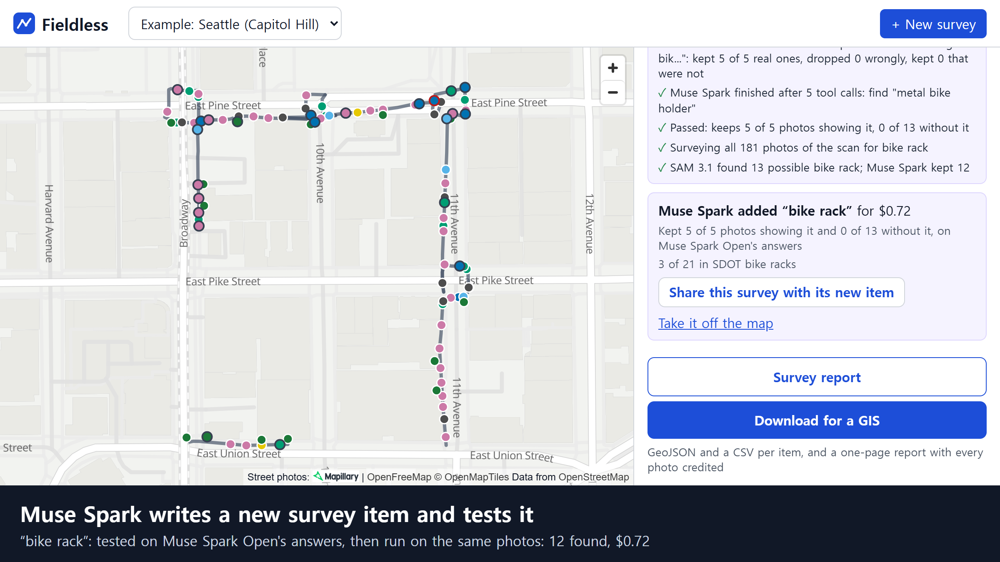

# Fieldless

**Street surveys without the fieldwork.** Fieldless automates a first pass from existing public street photos and prepares evidence-linked records for human review. In Ballard, Seattle, the initial 0.92 km survey took 10.3 minutes and $3.33 in Meta API charges. The separately run second looks added $2.30: a Meta API subtotal of $5.63, or $6.10 per km, for the Record Update List. Baseten, hosting and human review are excluded; end-to-end list time and actual fieldwork savings have not been measured.

What a city gets from a survey is a **Record Update List**. In Ballard, the photos reached 94 of 3,292 city records in the survey's box or its photos' view (2.9%). The revised list has 29 desk-review candidates (1 correction candidate, 25 date-review candidates, 3 with no change proposed) and 65 records needing more evidence; 26 other objects are candidates to compare with the lists, including 7 unresolved ones. These are review categories, not measured visits avoided. The survey says nothing about the other 3,198 records. Each row keeps the city's available IDs and fields, the photo's observation date, evidence where available and any unresolved attribute, as a page, CSV and GeoJSON. It changes nothing in the city's records.

One pass over the photos records street assets (utility and streetlight poles, street trees, public litter cans, parking pay stations), a condition (curb ramps without a detectable warning surface) and records (steps at shop entrances, objects blocking the walkway). A new item is a sentence away: type it in the app, and Muse Spark writes it, tests it and surveys the same photos. It is built on Meta's Mapillary imagery, SAM 3.1, Muse Spark and Muse Spark Open, with Muse Glimmer, served on Modal, for large runs.

**Try it:** [live app](https://edward321416--fieldless-web.us-east.modal.run) (open a finished survey, or start your own; spend is capped) · the three example surveys: [Seattle, Ballard](https://edward321416--fieldless-web.us-east.modal.run/#scan=30) · [New York, Park Avenue South](https://edward321416--fieldless-web.us-east.modal.run/#scan=31) · [Seattle, Capitol Hill](https://edward321416--fieldless-web.us-east.modal.run/#scan=17) (older photos) · [read-only demo](https://huggingface.co/spaces/BBONG1201/fieldless) (the same surveys, static) · [Capitol Hill with an item Muse Spark added](https://edward321416--fieldless-web.us-east.modal.run/#scan=17&item=4)


## Why

Street surveys are slow, expensive and quickly out of date. Published figures below describe broader fieldwork; they are context, not a measured like-for-like savings claim.

- **Seattle** sent 14 interns to walk 2,336 miles of sidewalk over 16 weeks (a $400,000 budget, 2017). ([SDOT](https://seattle.gov/documents/Departments/SDOT/About/SidewalkAssessExecSummary_4_6_2018R5.pdf))
- **Republic, Missouri** is using a $240,000 federal grant in 2026 to have engineers ride its sidewalks and map width, slope and damage, to update an ADA transition plan last made in 2016. ([KY3, 2026](https://www.ky3.com/2026/08/10/what-are-those-machines-driving-around-republic-mo-sidewalks/))
- US cities with 50+ employees must keep an ADA inventory of barriers in their streets. Only 13% of 401 surveyed entities had a transition plan readily available. ([Eisenberg et al., *Cities*, 2020](https://doi.org/10.1016/j.cities.2020.102720))
- Chicago-area cities measured manual sidewalk data collection at about $1,600 per mile, against $64 per mile when people reviewed street photos instead. ([CMAP, 2026](https://cmap.illinois.gov/news-updates/measuring-sidewalk-accessibility/))
- In 2022 the author was one of about twenty people a district office in Daejeon, Korea paid to walk its streets for three months and record every street light by hand.

Photo-based surveying already reduces fieldwork, and existing products also use AI. [Project Sidewalk](https://github.com/ProjectSidewalk/SidewalkWebpage#ai-in-project-sidewalk) operates AI label validation and pilots automatic curb-ramp labeling; [Mapillary](https://help.mapillary.com/hc/en-us/articles/360003021152-Types-of-map-data) extracts detections and map features. Fieldless demonstrates sentence-defined survey items, multiple asset and condition categories, city-record comparison, and an evidence-linked review list together. We have not measured a productivity advantage over these tools.

## What one survey records

One pass over the photos fills a whole survey. Each item is a few sentences in a standards file (`pipeline/standards/us.toml`, `kr.toml`), not a trained model.

| Kind | Survey item (Seattle, US standard) | Checked against |
|---|---|---|
| Asset inventory | Utility and streetlight poles · street trees · public litter cans · parking pay stations | Seattle's open inventories (City Light poles, SDOT trees, SPU litter cans, SDOT pay stations) |
| Condition | Curb ramps without a detectable warning surface | Seattle's curb-ramp inventory, plus photo checks |
| Record | Steps at shop entrances · objects blocking the walkway, with the photo date | Photo checks |
| Added in the app | Anything a photo can show, typed as a target (for example "bike rack") | Muse Spark Open's answers on sample photos, and the city's list when it has one (SDOT bike racks) |

It reports only what a photo can settle. Slopes, widths and sub-inch lips need a tape measure, and Fieldless says so instead of guessing.

Where a city keeps a list of an item, the survey is set against it: Seattle's lists for poles, trees, litter cans, pay stations and curb ramps, and New York's for trees, litter cans, pay stations and curb ramps (New York has no usable pole list). That comparison is what the update list below is built on.

## What a city gets: the Record Update List

The update list is the survey's result for a city's asset team. Every city record in view of the photos, and every object the photos show that no city list has, gets one row with one suggestion:

| Row | What the city could do | When a row gets it |
|---|---|---|
| Correct the record | Look at the photo, then correct the record if it holds | Seen in a photo, and two models both answer a yes/no field of the city's list differently from the city |
| Update the date | Review the city's date: the photo is newer | Seen in a photo and the models are sure; the city's list has a verification date and the photo is newer than it |
| No change | Review the presence observation; no change is proposed | Seen in a photo, any required attribute check is settled, and there is no verification date to review |
| Visit on site | Obtain a newer photo or check on site | Presence or a required record attribute remains unresolved, failed or was not checked. This legacy action name does not mean a visit has actually been scheduled |
| Compare with the list | Compare with nearby records, then decide | An object the photos show that is on none of the city's lists |

A record counts as seen when the survey found it in its own photos, or when a second look at its spot in a photo gets a yes from both Muse Spark and Muse Spark Open; that photo is a survey photo or a flat view cut from a newer 360-degree photo. Places with no city record are asked the same way, as control spots, to show how far a yes can be trusted. For seen records whose city list holds a yes/no a photo can answer (a pole's street light, a curb ramp's warning surface), Muse Spark is also asked whether it still holds, and Muse Spark Open where Muse Spark answers against the city. An AI assistant (Claude, the coding assistant used to build Fieldless), not a person, looked at photos of the findings and of the second looks: an object on no list that it judged wrong or a repeat is left off, and a second look whose box sat on something else is sent back to "Not determined".

**Presence and attributes are separate.** Seeing a pole does not establish whether it holds a lamp. Each configured attribute check remains `agree`, `different`, `unsettled` or `not_checked`; unresolved or missing required checks cannot enter the desk-review candidate count. The API retains `no_visit` for compatibility and also exposes `desk_review_candidates`; neither measures visits avoided. A candidate still needs the city's review.

Today a row can be "Update the date" only where the city's list has a verification date (Seattle's trees and curb ramps), and "Correct the record" only where it holds a yes/no field a photo can answer (a pole's street light, a curb ramp's warning surface). Another item needs a field and a question added to `eval/cities/*.toml`.

Every row is a suggestion for the city to decide on. The list changes nothing in a city's records, never fills one of the city's date fields (the photo's date has its own column, "Seen in photo on": an observation, not an inspection), and does not replace site checks. Rows from the city's lists keep the city's position; an object on no list carries the camera's position, rated Unknown (within 50 ft), so some may be records already listed. The page says it was prepared by Fieldless from public street photos, is not a city document, and has not been reviewed by the city.

### Review a proposed ledger change

Open **Review for ledger** in the Update list to check the record ID, position and dated photo. Confirm that it is the same asset and that its attribute is readable, choose the actual value, and enter a reviewer name and reason. Nearby records with photos taken seconds apart need another identity check. Nothing is approved by default. The entered reviewer name is a self-declared review, not an authenticated municipal approval.

The browser prepares a review journal, a source snapshot, a changes CSV and a separate observations CSV. Reviews stay in the current tab: download them before leaving. Only explicitly reviewed changes to configured yes/no attributes enter the changes CSV. Photo dates never replace official inspection or verification dates; tree observations stay observations. Uncertain identity or unreadable evidence stays on hold. The review workspace also works on the static demo without writing to its server.

To check the review against an authorized local copy of the city's GeoJSON layers and create a **separate revised copy**, run from the repository:

```bash
python -m eval.ledger_apply --check ledger-review-scan30-source.json \
  --journal ledger-review-scan30-journal.json \
  --input-dir path/to/current-city-layers --output-dir path/to/new-reviewed-copy
```

The tool checks the source snapshot, exact record ID, original properties, position and before value before writing any changes. Missing or duplicate IDs, stale data and disallowed fields reject the package. It preserves the input files and writes an audit alongside the new copy. The city's authorized operator still decides whether and how to import that copy into the official ledger. No city API or official ledger is changed by Fieldless.

## How it works

```
area (bbox) → Mapillary photos → scene scan → survey items → evidence → map + report → files for a GIS → Record Update List (with a city's lists)
```

1. **Collect** (Mapillary API v4): pedestrian, non-panorama photo sequences in the area, thinned to about one photo every 2 m, keeping a photo wherever the walker turns.
2. **Scene scan** (Muse Spark, video input): Spark watches each sequence as a short video (photo numbers burned in) and lists the entrances and the kinds of objects on the sidewalk. Its words become SAM prompts.
3. **Survey items** (SAM 3.1 + Muse Spark): for each item, SAM 3.1 finds the `find` phrase. Curb ramps and poles are tracked across a sequence as video, one row per object; trees, litter cans and pay stations are found on photos and grouped by distance walked (8 m for things in rows, 15 m for the rest). Two boxes on one object in one photo become one row. Muse Spark answers the item's question on the best photo in a fixed JSON format with a box and a reason, or says "unclear". When it calls a marked object unclear, it is asked once more with the box enlarged, and the card says what the first look said. A detail on a box under 7% of the photo's height is too small to judge and stays unclear. When Spark says the thing is not in the photo at all (SAM found a driveway, not a curb ramp), the find is set aside, not hidden: it is listed in the export.
   - **Open-weight judge for large runs** (Muse Glimmer 30B, served by us on Modal): in a run started with `--glimmer`, Glimmer answers first the street-asset checks whose item says `judge = "glimmer"`. When it is unclear or fails, Spark answers; Spark also audits 10% of Glimmer's answers, and a disagreement is marked "Models unsure" on its card. Which items Glimmer takes was measured per item against the city's inventory and labelled photos (poles, litter cans, pay stations: yes; street trees: not yet). A small survey is faster and no dearer on Muse Spark alone: a 199-photo Capitol Hill scan with Glimmer took 34 min (two GPU starts, about 7 min of waiting) and saved about $0.56 of Spark calls while keeping the GPU on for about 17 minutes (about $1.15, estimated). The live site and plain runs use Muse Spark.
4. **Second opinion** (Muse Spark Open on Baseten): every possible defect on the US survey items is asked again on the same photo. If the two models disagree, the finding is recorded as unclear, not as a defect.
5. **Evidence**: faces and plates blurred with SAM 3.1; every photo shows its Mapillary creator, logo and link.
6. **On the map**: picking a finding shows on the map where its photo was taken and which way it looked, with the photo and the model's box over the map; the card says what Muse Spark was asked and answered.
7. **Report and files**: a survey report page (`/api/scans/<id>/report`, also in the download) with the counts, a map, the evidence photo of every finding, what photos cannot settle, and a short text Muse Spark writes from the counts (code drops any sentence with a number or a judging word, so every number comes from code). "Download for a GIS" gives GeoJSON and a CSV per item, and the update list's page and tables when the survey has one. Where the city keeps a list (`eval/cities/seattle.toml`), each finding carries the city's own field names: the matched record's IDs (a tree's `COMPKEY` and `UNITID`, a pole's `SCLNR`), whether it matched, and the survey's answer in the city's own field (`DETWARN_EXISTS` for curb ramps); a CSV per item lists the city records in the photos' view that the survey did not find, by their IDs. Every row keeps its photo's creator, link and licence.
8. **Record Update List** (`eval/second_look.py`, `eval/pano_look.py`, `eval/record_check.py`, `eval/asset_check.py`, then `assist/asset_check.py`; see [What a city gets](#what-a-city-gets-the-record-update-list)): for a finished survey and a city's lists, the survey's own comparison says which city records it found. For the others, Muse Spark looks again at the record's spot in a photo, and Muse Spark Open is asked again where Muse Spark says yes. Seen records with a yes/no field a photo can answer get a value check. `eval/asset_check.py` gives every record one row and one suggestion, and `assist/asset_check.py` writes the page and the CSV and GeoJSON tables (`update_list.html`, `.csv` and `.geojson` in the download). These steps run offline on the example surveys, so a survey you start yourself has no update list.

Every stage saves its state, so a stopped scan resumes. Each scan has a cost cap, enforced in code.

### What the app shows

- **Overview.** A first visit opens on one page about the first example survey, Ballard: its cost per km (the survey's own) beside a published walking survey, a way into its update list, every item with a photo, how the survey rules, the city's records and the photos meet, what backs the numbers, and the three example surveys side by side. A link ending `#scan=30`, `#scan=31` or `#scan=17` opens that survey directly.
- **Update list.** The "Update list" tab under a finished example survey (its badge, 29/94 for Ballard, is desk-review candidates out of records within photo reach). It opens with how many of the city's records in the survey's box or its photos' view the photos reached and how many of those are desk-review candidates, how many more objects are not on the city's lists, and how the seen records were seen (by the survey, on a second look, on a second look in panoramas). A table gives each asset's records in view and how many are review candidates, need more evidence or need comparison. Buttons filter the rows by "Correct the record", "Update the date", "No change", "Visit on site" and "Compare with the list" (the ones a survey has). Each row shows the city's record number and place, what the city says and what the photo shows where the row suggests a change, the city's date and the photo's date and, where a photo settled it, that photo with the model's box and its credit; a visit row without a photo of its own links a survey photo taken near the record's position (on Mapillary, with its distance and credit; it may not show the record); "Show on the map" opens its place. "Open the report" opens the "<area> Record Update List" page, and "Table (.csv)" and "Table (.geojson)" download `update-list-<id>.csv` and `update-list-<id>.geojson`. Every row is a suggestion, and the screen says so. New York's list also shows the city's credit.
- **City records.** On the results map, "City records" draws each finding by how it pairs with the city's own list: filled if it is on the list, a ring if the list lacks it, and a faint dot for each city record in the photos' view that the survey did not find. Clicking a faint dot shows the city's ids for that record, to look up or visit. In every view a small gray dot marks each city record in the box that no photo reached (3,198 in Ballard), so the box shows what the photos covered; the survey says nothing about those. Clicking a gray dot shows the city's ids for that record, as for a faint dot.
- **Add a survey item.** Under a finished survey, "+ Add a survey item" has Muse Spark write an item from a word, test it and survey the same photos (below). Making one on the live site needs an invite code; the finished runs on Capitol Hill are open as examples.
- **How this survey was made.** Each finished demo survey lists its stages, the Meta model that did each, its calls and its cost (`/api/scans/{id}/calls`). For Ballard it reads 676 model calls, $3.33 for the initial survey, 10.3 min of processing: the survey only, without the second looks behind its update list.
- **Survey report and files.** "Survey report" opens the survey's own report (counts, map, the photo of every finding, what photos cannot settle). "Download for a GIS" gives a zip with that report, GeoJSON and a CSV per item, the blurred evidence photos and, for a survey with an update list, its page and tables.
- **Dispatch and GIS Diff.** The update list takes their place on a survey that has one. A survey without one still shows them. **Dispatch** (every survey you start yourself) lists the findings to check on site: possible defects first ("P1 Possible defect" on screen), then what the models were unsure of ("P2 Site check"), each with its street name and photo, and a work order CSV whose priority column reads "P1 · Possible defect" and "P2 · Field verification". **GIS Diff** (only where a city check was made but no update list) shows the findings the city's list lacks and the city's records the survey did not find, as GeoJSON (the "Differences (.geojson)" button, `scan_<id>_city_diff.geojson`), a list for the city to check.
- **Choosing an area.** Search a place by name and press Enter: the browser asks OpenStreetMap's Nominatim only then, never while you type (the preset places filter in the page). Or draw a box on the map and drag its corners.

## New survey items, written and tested by Muse Spark

**In the app.** Under a finished survey, "Add a survey item" takes a target, for example "bike rack". Muse Spark then works as an agent, and the panel shows each step as it happens:

1. It drafts the item: what SAM 3.1 should find and the yes/no question to ask.
2. Muse Spark Open, a second, open-weight model, answers whether each of 18 photos of the survey shows the target. Those model answers are the calibration key.
3. Muse Spark tries SAM 3.1 phrases and rewords its question until the item keeps at least 70% of the photos that show the target and at most 20% of those that do not (within a tool-call budget and a $1 cap).
4. An item that passes runs on every photo of the survey and appears on the map in its own color, marked "added by the agent, not in the survey standard yet". One that fails says why and changes nothing.

On the Capitol Hill survey (2022 photos), "bike rack" settled on the phrase "metal bike holder" after 5 tool calls, kept 5 of 5 photos that show a rack and 0 of 13 that do not, and found 12 racks in 181 photos, 3 of the 21 in SDOT's bike-rack list along the walk, for $0.72 ([open it](https://edward321416--fieldless-web.us-east.modal.run/#scan=17&item=4)). "Fire hydrant" kept 4 of 4 photos that show one and 0 of 14 that do not, and found 5 hydrants for $0.61 ([open it](https://edward321416--fieldless-web.us-east.modal.run/#scan=17&item=5)). No item-specific detector training or new field capture was needed. The same 18 photos guide prompt tuning and the pass check, so this is model agreement on reused examples, not held-out accuracy or human ground truth. "Share" copies a link to what is on screen.



**From a rule.** On the command line, Muse Spark reads a rule (for example the 2010 ADA Standards, PDF), drafts the items a pedestrian photo can settle with section, page and an exact quote, and lists those it cannot (slopes, widths) with the reason. It then tests each one with tools on labelled photos: SAM 3.1 tries the `find` phrase, Muse Spark answers the question, code scores both, and Spark rewords and retries. Testing the curb-ramp contrast item, it tried 5 SAM phrases and chose "curb cut" (10 of 12 ramps found, 0 false); "curb ramp" itself found 0 of 12. See [Survey items from a rule](#survey-items-from-a-rule-muse-spark-agent).

## Meta AI used

| Meta technology | What it does | Runs on |
|---|---|---|
| **Mapillary** | The input: open pedestrian-view street photos (CC BY-SA 4.0) | Mapillary API v4; the photos are downloaded and never committed |
| **SAM 3.1** | Finds every survey item by name (text prompts), tracks objects across a sequence (video), outlines a step from Spark's box (box prompt), and blurs people and plates | Meta Model API (`api.meta.ai`), hosted by Meta; key `MODEL_API_KEY` |
| **Muse Spark** | Watches photo sequences as video, judges each item in a fixed JSON format with a box and a reason, writes and tests new survey items as an agent that calls SAM 3.1 as a tool, reads a rule PDF, writes the report's text, and looks again at a city record's spot in a photo for the update list | Meta Model API (`api.meta.ai`), hosted by Meta; key `MODEL_API_KEY` |
| **Muse Spark Open** (open weights) | Gives the answers a new item is tested against, a second opinion on every possible defect on the US survey items, and the second answer on the update list's second looks and value checks: a row says "Correct the record" only when both models differ from the city | Baseten (`meta-models/muse-spark-open-1026`); optional, key `BASETEN_API_KEY`. Without it surveys run on Muse Spark alone |
| **Muse Glimmer** (open weights) | Takes the street-asset checks in large runs (`--glimmer`); Spark covers its unclear answers and audits 10%. On a busy GPU a check costs about $0.00075 against $0.012 on Muse Spark (measured, 300 checks at 32 in flight). Re-judging a Seattle scan, it matched 12 of 29 of the city's poles where Spark matched 13 of 31 (the points in view differ by run); litter cans and pay stations came out the same, and 6 of 7 Spark audits agreed. In a small survey it is slower and no cheaper, because starting the GPU takes four to six minutes, so the live site uses Muse Spark | Served by us on one Modal H100 with vLLM (`deploy/modal_glimmer.py`, scales to zero); used only in runs started with `--glimmer`. `modal deploy deploy/modal_glimmer.py` prints the server's URL: set it as `GLIMMER_URL`, which those runs need. Its own key is derived from `MODEL_API_KEY`, so there is nothing else to add |

In the Ballard survey, the app's "How this survey was made" lists 676 model calls for $3.33 for the initial survey: SAM 3.1 answered 561 (119 on the sidewalk, 308 on the survey items, 4 on entrances, 130 blurring evidence photos) and Muse Spark 115 (4 reading the scene, 107 on the survey items, 3 on entrances, 1 writing the report's text); Muse Spark Open made no calls in the survey's own stages. The item checks alone were 308 SAM 3.1 calls and 107 Muse Spark calls ($2.27). The second looks behind the update list are further calls, not in these counts ($2.30 more for Ballard; see Results).

## Results (measured)

All numbers are measured by us with the code in `eval/` (city check, second looks, value check, precision) on the three example surveys in the demo, newest photos first. Each count of findings right or wrong was judged on the evidence photos by an AI assistant (Claude, the coding assistant used to build Fieldless), not by a person.

- **Seattle, Ballard** (survey photos 2026-05-18 to 2026-07-01): 199 photos over 0.92 km, one pass with five photo checks: 10.3 min of processing and 676 model calls, $3.33 ($3.60 per km) for the survey itself.
  - Meta API subtotal for the update list: its second looks cost $2.30 more than the survey: asking again about records the survey did not see $1.10, a look at 2025 panoramas $0.77, a record value check $0.17 and blurring $0.26. The Meta API subtotal was $5.63, or $6.10 per km; Baseten, hosting and review labor are excluded.
  - Update list: of 3,292 city records in the survey's box or its photos' view, the photos reached 94: 29 are desk-review candidates (1 correction, 25 date reviews, 3 with no change proposed) and 65 need more evidence. The 14 unresolved attribute checks are included in those 65, even when the object itself was seen. 26 more objects are not on the city's lists, 7 of them not settled. 53 of the 94 were seen in photos (27 by the survey, 9 on a second look, 17 on a second look in panoramas from 2025) and 41 are not determined.
  - Match with the city's lists, by the survey alone: 27 of 94 (poles 10/22, street trees 11/45, litter cans 1/2, curb ramps 5/25, pay stations 0/0). The update list's 53 seen adds its second looks to these 27.
  - Control spots with no city record: two models agreed on an object at 0 of 17 (survey photos) and 1 of 10 (panoramas; a real pole across the intersection).
  - Value check: of 22 seen records whose city list holds a yes/no a photo can answer, the models agreed with the city on 7, differed on 1 and left 14 not determined.
  - Checked by the AI assistant: of 57 recorded findings, 43 right, 3 wrong and 11 could not be told.
- **New York, Park Avenue South** (survey photos 2026-02-02 to 2026-02-09): 181 photos over 0.70 km, 7.9 min of processing and 641 model calls, $2.97 ($4.24 per km) for the survey itself. Its second looks cost $1.07 more (a second look $1.05, blurring $0.02; no panoramas exist in that area), so the Meta API subtotal was $4.04, or $5.77 per km. Update list: of the 79 city records in view, 9 are desk-review candidates (all with no change proposed) and 70 need more evidence; 20 more objects are not on the city's lists, 3 of them not settled. Match with the city's lists: 9 of 79 (street trees 4/29, litter cans 0/4, pay stations 3/7, curb ramps 2/39; no usable pole list). Checked by the AI assistant: of 63 recorded findings, 52 right (83%), 1 wrong and 10 could not be told.
- **Seattle, Capitol Hill** (survey photos from 2022, an older example): 181 photos over 0.94 km, 7.0 min of processing (about 8 min with collecting the photos), $4.21 ($4.48 per km) for the survey itself, as the live app shows. Its second looks cost $2.30 more (a second look $0.90, a test sample $0.27, panoramas $0.80, a value check $0.20, blurring $0.12; each part rounded to the cent), so the Meta API subtotal was $6.51, or $6.93 per km. Update list: of the 107 city records in view, 44 are desk-review candidates and 63 need more evidence; 19 unresolved attribute checks were excluded from candidates. Match with the city's lists: 45 of 107 (poles 13/29, street trees 25/39, litter cans 1/8, curb ramps 4/27, pay stations 2/4). Checked by the AI assistant: 73 of 86 recorded findings right.
- **What differs.** Ballard and New York have newer survey photos (2026 against 2022) and a lower cost per km than Capitol Hill: $3.60 and $4.24 against $4.48 for the survey, $6.10 and $5.77 against $6.93 for the whole list. Their match with the city's lists is lower (29% and 11% against 42%), and so is the share of findings judged right (75% and 83% against 85%).
- **Muse Spark item agent**: in the app, on the Capitol Hill survey, "bike rack" passed its test and found 12 racks for $0.72, and "fire hydrant" passed and found 5 hydrants for $0.61 (above). From the ADA excerpt it wrote 6 items and set aside 16 requirements that need measuring.
- For scale, field surveys take weeks to months and roughly $100–$1,000 per km. Those surveys record more items, so this compares scale, not the same job. Fieldless's per-km figure is the survey itself, not the whole update list (Ballard's whole list was $6.10 per km).

## Data, privacy and attribution

- Photos come from [Mapillary](https://www.mapillary.com) under CC BY-SA 4.0. Every evidence photo shows its creator, the Mapillary logo and a link. Downloaded photos are never committed; the one photo in a screenshot (`docs/images/update-list-revised.png`) is a small evidence photo with its credit in frame.
- Faces and licence plates are blurred, and blurring is only ever added.
- City inventories used for checking are the City of Seattle's open GIS layers (SDOT curb ramps, trees, pay stations and bike racks; Seattle City Light poles; Seattle Public Utilities litter cans). They carry no stated licence, only the City's notice that it makes no warranty of accuracy. The repo keeps only the city point IDs that label the small test sets in `assist/testsets/`, not the layers.
- New York's city records are NYC Open Data. Credit: "City records: NYC Open Data (DOT, Parks, DSNY, DEP), downloaded Nov 1, 2026, clipped to the survey area. The City of New York does not warrant them or endorse this survey." The repo does not keep those layers either. The live API does serve the positions and the city's ids (item, longitude, latitude, ids) of the records no photo reached, so the map can show them and a click can say what each one is.
- This is not a navigation app and not an enforcement tool. It records what photos show so a city can decide what to do about it; the update list is a suggestion, prepared by Fieldless from public photos, and no city has reviewed it.

## Limits

- **Photo dates differ by example, and coverage depends on Mapillary.** Ballard's survey photos are from 2026-05-18 to 2026-07-01, but its update list also uses panoramas from 2025, so "2026" is true of its survey photos only. New York's survey photos are from 2026-02-02 to 2026-02-09. Capitol Hill's survey photos are from 2022 (its panorama rows, from 2025). A record seen in a photo was there on that photo's date, and may have changed since.
- **Ballard is residential streets.** It has no pay stations, only 2 litter-can records, and street trees are 48% of its city records (45 of 94), so its numbers say most about trees, poles and curb ramps.
- **One contributor per survey.** Ballard's survey photos come from one Mapillary contributor, and so do New York's and Capitol Hill's, so each result rests on one person's route and camera. How much a scan finds depends on which walk its photos come from: two walks of the same Capitol Hill blocks found 13 of 29 and 0 of 24 of the city's poles.
- **New York matches few of the city's records** (9 of 79), and we do not know why. We have not tested a cause.
- **Suggestions only.** Every row of the update list is a suggestion for the city to decide on. It changes nothing in a city's records and does not replace site checks. "Update the date" compares a photo's date with the city's own date field (`LAST_VERIFY_DATE` for trees, `VERIFICATION_DATE` for curb ramps); we found no document saying those fields record when a crew checked the record on site.
- **The cost per km is the survey itself.** Ballard's $3.33 ($3.60 per km, 0.92 km, 10.3 min) is the survey. The second looks behind its update list cost $2.30 more (asking again about records the survey did not see $1.10, a look at 2025 panoramas $0.77, a record value check $0.17, blurring $0.26), so the Meta API subtotal was $5.63, or $6.10 per km. New York's survey cost $2.97 ($4.24 per km); its second looks cost $1.07 more (a second look $1.05, blurring $0.02; no panoramas exist in that area), so the Meta API subtotal was $4.04, or $5.77 per km. Capitol Hill's $4.21 ($4.48 per km) is the survey only, as the live app shows; its second looks cost $2.30 more (a second look $0.90, a test sample $0.27, panoramas $0.80, a value check $0.20, blurring $0.12; each part rounded to the cent), so the Meta API subtotal was $6.51, or $6.93 per km. These are Meta API charges: the 87 Muse Spark Open answers in the second looks ran on Baseten credits and are not priced here.
- Some Mapillary walks are stored turned on their side, and their metadata does not say so. Fieldless does not detect this yet, and such photos yield fewer finds (in one Capitol Hill test, one walk of four: 53 of 181 photos).
- A photo cannot settle slopes, widths or sub-inch lips; distant corners come back "unclear".
- Accuracy labels for the demo areas were made from the photos by the AI assistant, not by a person, or come from city inventories that can be older or newer than the photos. No untouched sequence-level evaluation or city-reviewer acceptance study has been completed. Presence accuracy, record matching, attribute accuracy and review effort must be measured separately before claiming total savings.
- The speed comparison uses published field-survey figures, which cover more items than Fieldless does today. Fieldless is a narrower first pass than the 2017 survey, which recorded surface condition and slope. Fieldless's per-km figure is the survey itself, not the whole update list.

## Built during the Meta Global AI Developer Hackathon

All code in this repository was written during the hackathon, starting after kickoff on 2026-10-26 12:00 PM ET. `spike/` holds the day-1 feasibility tests, `pipeline/` the survey pipeline, `server/` and `web/` the app, `assist/` the Muse Spark item agent, the report and the export, `deploy/` the live app and the Muse Glimmer server, `eval/` the evaluation.

**Tools.** All AI features in the product use Meta models. The code was written with the help of **Claude Code** (Anthropic) as a coding assistant. The author designed, reviewed and ran everything.

The repository was renamed from `threshold`, its earlier working name, which a few settings (`THRESHOLD_DATA`, `THRESHOLD_RUN`) and the database file (`threshold.db`) still use.

## Run it yourself

**No keys?** The [read-only demo](https://huggingface.co/spaces/BBONG1201/fieldless) shows the recorded surveys, reports and files with no key and no account. Every number there comes from a real run.

### Setup

Needs Python 3.14 and `ffmpeg`/`ffprobe` on PATH. Older versions fail on negative `--bbox` values.

```
python -m venv .venv
.venv/Scripts/python -m pip install -r requirements.txt -c constraints.txt   # macOS/Linux: .venv/bin/python
.venv/Scripts/python -m pytest -q                                            # offline tests, no API calls
```

Copy `.env.example` to `.env` and fill in `MODEL_API_KEY` (the Meta Model API: SAM 3.1 and Muse Spark) and `MAPILLARY_TOKEN`. `BASETEN_API_KEY` (Muse Spark Open) is optional. The `.env` can sit in the repo root (git-ignored) or in any parent folder.

### Survey items from a rule (Muse Spark agent)

A survey item is two sentences: what SAM 3.1 should find, and the yes/no question Muse Spark answers about it. The
`assist` agent writes them from the rule itself:

1. Muse Spark reads a rule excerpt (PDF) and drafts the requirements a pedestrian photo can settle, each with its
   section, page and an exact quote. It also lists the ones a photo cannot settle (slopes, widths) and why.
2. Code drops any draft whose section or quote is not in the rule.
3. Muse Spark then tests each item with two tools on labelled photos: SAM 3.1 tries the `find` phrase, Muse Spark
   answers the `ask`, and code scores both. It revises the phrase or the question and tests again, within 20 tool
   calls and a spend cap.

```
.venv/Scripts/python -m assist.run_author --rule ada2010 --testset seattle_ramps --run author-ada
```

While it runs, it prints each tool call the agent makes and what code measured, for example
`[5] SAM 3.1 finds "curb cut": 10 of 12 photos that show it, 0 of 4 that do not`.
The result is a TOML file of `[[check]]` items with their source and measured scores, and a report. Nothing is
added to the standard for you: to use an item, copy it into `pipeline/standards/us.toml`. The excerpt in
`assist/rules/` is from the 2010 ADA Standards for Accessible Design (U.S. Department of Justice, public domain).
The test set `assist/testsets/seattle_ramps.json` lists Mapillary image ids with labels made from the photos.

Inventory items record where something is (streetlight poles, street trees, litter cans), not a defect, so they need no
rule: Muse Spark drafts one from the target's name, and the agent picks the SAM 3.1 phrase and tests that Muse Spark
confirms what SAM found ("yes" is an asset point, "no" drops a false find) on photos labelled only by whether they show
the target, within 12 tool calls. The TOML item has `inventory = true` and no `report_when`.

```
.venv/Scripts/python -m assist.run_inventory --target "streetlight pole" --testset seattle_poles --run inv-poles
```

### Run the app

The app is one FastAPI server (`server/`) that also serves the built web app (`web/`).

Local development, in two terminals from the repo root:

```bash
.venv/Scripts/python -m uvicorn server.app:create_app --factory --port 8000
npm --prefix web install
npm --prefix web run dev
```

Then open http://localhost:5173. Vite forwards `/api` to port 8000.

With Docker:

```bash
docker build -t fieldless .
docker run --rm -p 8000:8000 -v fieldless-data:/data \
  -e MODEL_API_KEY -e MAPILLARY_TOKEN fieldless
```

Then open http://localhost:8000.

| Variable | Needed | Meaning |
|---|---|---|
| `MODEL_API_KEY` | yes | Meta Model API key |
| `MAPILLARY_TOKEN` | yes | Mapillary client token |
| `BASETEN_API_KEY` | no | Muse Spark Open on Baseten: the second opinion on possible defects, and the answers new survey items are tested against |
| `ITEM_INVITE_CODE` | no | if set, "Add a survey item" in the app needs this code (default: `INVITE_CODE`); without either, the app shows the finished example items only |
| `THRESHOLD_DATA` | no | data folder (the image uses `/data`) |
| `INVITE_CODE` | no | if set, starting a survey needs this code |
| `IP_HASH_SALT` | in production | random salt for the hashed client address; without it a public default is used |
| `SCANS_PER_IP_PER_DAY` | no | default 3; 0 turns the per-address limit off |
| `PUBLIC_COST_CAP_USD` | no | total spend of the surveys visitors start; past it, new surveys stop |
| `GLIMMER_URL` | no | the deployed `fieldless-glimmer` address; checks with `judge = "glimmer"` ask Muse Glimmer first |
| `GLIMMER_DAILY_USD` | no | Glimmer's estimated GPU spend a day, default 3; past it, Muse Spark judges until tomorrow (UTC) |
| `GLIMMER_TOTAL_USD` | no | Glimmer's estimated GPU spend in all; past it, Muse Spark judges from then on |
| `DEMO_SCANS` | no | surveys listed first, as `id:Name;id:Name` |
| `THRESHOLD_RUN` | no | run folder under `<data>/runs`, default `server` |
| `HF_DATA_REPO` | no | private Hugging Face dataset that keeps the data on a host without a disk (with `HF_TOKEN`) |
| `BACKUP_DIR` | no | or a backup folder (a mounted Modal Volume) that keeps it |
| `PROXY_HOPS` | no | trusted proxies that append to `X-Forwarded-For`, default 1 (Railway); 0 when no proxy |

Keys are read only from the environment and are never logged. In production, mount a persistent volume at `/data`: the database, photo cache and evidence photos live there. The server runs one process (`--workers 1`), because surveys run one at a time on a background thread. The image installs the tested package versions in constraints.txt.

### Survey standards

What a scan looks for is written in sentences, one file per standard in `pipeline/standards/` (`us.toml` for the
United States, `kr.toml` for Korea). A scan uses KR when its area is in Korea and US elsewhere (`--standard` overrides).
`kr.toml` holds a Korean standard tried during the build; it is not part of the demo.
Each `[[check]]` names what SAM 3.1 finds in the photos (`find`), the noun the survey is about (`target`, `find` by
default) and the question Muse Spark answers about it:

```toml
[[check]]
id = "curb_ramp_warning"
find = "curb cut"
target = "curb ramp"
ask = "A curb ramp is the short sloped section where a pedestrian crossing meets the sidewalk. Driveways, alley entrances and plain raised curbs are not curb ramps; if the photo shows only those, set visible to false. If there is a curb ramp, does it have a detectable warning surface (a panel of raised truncated domes) at its bottom edge? If its bottom edge is too far away or too small to see, answer unclear."
report_when = "no"
label_yes = "Curb ramp with detectable warning"
label_no = "Curb ramp without detectable warning"
```

To survey something new, add a `[[check]]` and run the checks again on a finished scan (no training data is needed):

```bash
python -m pipeline.run_scan --resume SCAN_ID --run RUN --rerun defects --check NEW_ID
```

`--check` keeps the other items' rows and reviews.

A check with `inventory = true` maps assets instead of defects: every confirmed object is a point. Use it for things a
city keeps an inventory of (poles, trees, bins). It has no `report_when`; a "no" answer drops the pick, and the labels
default from `target`:

```toml
[[check]]
id = "utility_pole"
inventory = true
find = "street light pole"
target = "utility or streetlight pole"
ask = "Look at the tall pole closest to the camera along the sidewalk. Is it a pole for overhead lines or street lighting: a wooden or metal utility pole, a streetlight pole, or a traffic-signal pole with a light arm? Answer no for a tree, a sign post, a parking meter, a flagpole or a pole on private land. If the pole is too far away or mostly hidden to tell, answer unclear."
label_yes = "Utility or streetlight pole"
```

`group_m` gives things that stand in rows one row per that many metres of walk instead of one per run of photos: 8 m for poles and street trees, which stand close together (on two Seattle surveys it matched about 30% more of the city's poles and almost 40% more of its trees than 15 m, for a few more repeats of one object), and 15 m for litter cans and pay stations.

`judge = "glimmer"` (inventory checks only) lets Muse Glimmer, the open-weight model we serve on Modal (`deploy/modal_glimmer.py`), answer the check first in a run started with `--glimmer` (and `GLIMMER_URL`). Muse Spark answers what Glimmer calls unclear or cannot answer, and checks a tenth of the rest; a disagreement keeps Glimmer's answer and is marked `models_disagree` on its card. Each row records which model answered. Glimmer is for large runs: on a busy GPU one answer costs about a sixteenth of a Muse Spark call, but a small survey pays the GPU's start and idle time for a few dozen answers, so it is cheaper and faster on Muse Spark. The live site and plain `run_scan` use Muse Spark.

### Export a survey

```bash
python -m assist.report --run RUN --scan SCAN_ID [--area "Capitol Hill"] [--narrate]
```

This writes `report.md`, `report.html`, `survey_scan<id>.geojson` and one CSV per survey item into
`<run>/report_scan<id>/`, plus `survey_scan<id>_dropped.csv` (the finds the models set aside) and, when the scan has a
city check (`python -m eval.city_check --run RUN --scan SCAN_ID --city seattle`),
`survey_scan<id>_<item>_city_records_to_check.csv`. Every
finding sits at its photo's location with the photo's creator, Mapillary link and licence, and carries the city's own
field names when the city keeps a list of that item (`eval/cities/<city>.toml`); rows rejected in the app's review
(a survey you start yourself has one) are left out.
`--narrate` has Muse Spark write the summary, a paragraph per item and the priorities from the report's counts, with
each share already put in words by code ("about half", "most"); code drops any piece that names an unknown item, holds
a digit or judges ("violation", "accessible"). Without it no API key is needed; `--save` keeps the text for the app.

### Public demo (static)

The public demo is a static site: the web app plus the server's answers for a few surveys already run, read-only. `deploy/static_site.py` asks the real server app for every answer, so the demo shows what the live server shows.

```bash
hf auth login                      # a token with write access to your repos
python -m deploy.static_site --run <run> --scan <id>:<Name> --out data/site --space USER/fieldless
```

### Live on Modal

`deploy/modal_app.py` runs the server on Modal: one always-on container serves the web app and the API and runs surveys one at a time. SQLite runs on the container's disk; after every survey, review and item run the database and evidence photos are copied to a Modal Volume (`BACKUP_DIR`), and a new container restores them from there.

```bash
.venv/Scripts/python -m pip install modal -c constraints.txt   # the Modal client; not in requirements.txt
npm --prefix web install && npm --prefix web run build         # the container serves web/dist, which a fresh clone lacks
.venv/Scripts/python deploy/modal_app.py --seed data/runs/<run>   # once: the demo surveys
.venv/Scripts/python -m modal deploy deploy/modal_app.py
```

Both read `MODAL_TOKEN_ID`, `MODAL_TOKEN_SECRET` and the server's keys from the shared `.env`; only the server's keys go into the Modal secret. Anyone can start a survey, with no per-address limit (`SCANS_PER_IP_PER_DAY=0`). Meta API spend stays inside the $3 per-survey and $10 per-day caps and `PUBLIC_COST_CAP_USD` ($40) across all surveys visitors start; past it, new surveys stop and finished ones stay open. The recorded example surveys ran locally under higher caps (`--cap-usd`, for local runs only; Capitol Hill's was $5), so Ballard's $3.33 and Capitol Hill's $4.21 are not limit breaches. A survey started on the live site stops at $3 and shows its results so far. Adding a survey item in the app needs `ITEM_INVITE_CODE` and is capped at $1 a run, inside the same daily cap.

### On a Hugging Face Docker Space

A Docker Space (PRO on Hugging Face since 2026) has no disk that survives a restart, so the server can keep its database and evidence photos in a private Hugging Face dataset: it restores them on start and uploads them after each survey and review (`server/store.py`, on when `HF_DATA_REPO` is set). `python -m deploy.hf_space --space USER/fieldless --data USER/fieldless-data --salt` publishes it; then set `MODEL_API_KEY`, `MAPILLARY_TOKEN`, `INVITE_CODE` and `HF_TOKEN` as Space secrets.

## Author

Bong Seonghyun (봉성현), Sungkyunkwan University · X [@bongseongh9328](https://x.com/bongseongh9328)

## License

MIT. See `LICENSE`.
