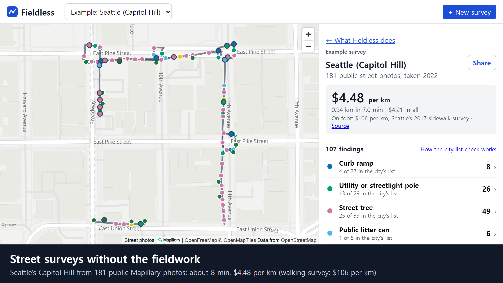
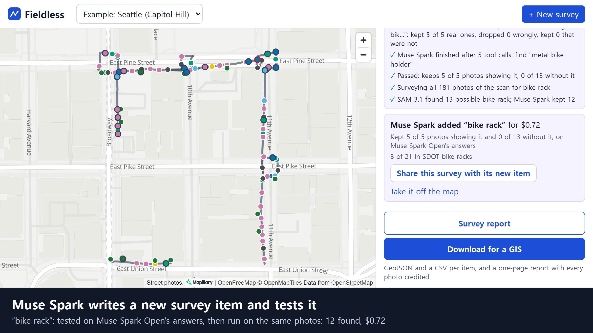

# Fieldless

**Street surveys without the fieldwork.** Cities still send people to walk every block to survey their streets: where the street lights, trees and bins are, which curb ramps lack a warning surface, which shops have steps. Fieldless does the first pass from street photos that already exist on Mapillary. Pick an area, and it records each survey item with an evidence photo. The point is speed and cost: weeks of walking against minutes of processing, at a few dollars per kilometer.

One survey covers street assets (utility and streetlight poles, street trees, public litter cans, parking pay stations), a condition (curb ramps without a detectable warning surface) and records (steps at shop entrances, objects blocking the walkway). A new item is a sentence away: type it in the app, and Muse Spark writes it, tests it and surveys the same photos. The same tool runs on Korean rules in Seoul. It is built on Meta's Mapillary imagery, SAM 3.1, Muse Spark and Muse Spark Open, with Muse Glimmer, served on Modal, for large runs.

**Try it:** [live app](https://edward321416--fieldless-web.us-east.modal.run) (open a finished survey, or start your own; spend is capped) · [read-only demo](https://huggingface.co/spaces/BBONG1201/fieldless) (the same surveys, static) · [the Seattle survey with the item Muse Spark added](https://edward321416--fieldless-web.us-east.modal.run/#scan=17&item=4)



## Why

Street surveys are slow, expensive and quickly out of date.

- **Seattle** sent 14 interns to walk 2,336 miles of sidewalk over 16 weeks ($400,000, 2017). ([SDOT](https://seattle.gov/documents/Departments/SDOT/About/SidewalkAssessExecSummary_4_6_2018R5.pdf))
- **Republic, Missouri** is using a $240,000 federal grant in 2026 to have engineers ride its sidewalks and map width, slope and damage, to update an ADA transition plan last made in 2016. ([KY3, 2026](https://www.ky3.com/2026/08/10/what-are-those-machines-driving-around-republic-mo-sidewalks/))
- US cities with 50+ employees must keep an ADA inventory of barriers in their streets. Only 13% of 401 surveyed entities had a transition plan readily available. ([Eisenberg et al., *Cities*, 2020](https://doi.org/10.1016/j.cities.2020.102720))
- Chicago-area cities measured manual sidewalk data collection at about $1,600 per mile, against $64 per mile when people reviewed street photos instead. ([CMAP, 2026](https://cmap.illinois.gov/news-updates/measuring-sidewalk-accessibility/))
- In 2022 the author was one of about twenty people a district office in Daejeon, Korea paid to walk its streets for three months and record every street light by hand.

Looking at photos is already far cheaper than walking. Fieldless goes one step further and lets AI take the first look.

## What one survey records

One pass over the photos fills a whole survey. Each item is a few sentences in a standards file (`pipeline/standards/us.toml`, `kr.toml`), not a trained model.

| Kind | Survey item (Seattle, US standard) | Checked against |
|---|---|---|
| Asset inventory | Utility and streetlight poles · street trees · public litter cans · parking pay stations | Seattle's open inventories (City Light poles, SDOT trees, SPU litter cans, SDOT pay stations) |
| Condition | Curb ramps without a detectable warning surface | Seattle's curb-ramp inventory, plus photo checks |
| Record | Steps at shop entrances · objects blocking the walkway, with the photo date | Photo checks |
| Added in the app | Anything a photo can show, typed as a target (for example "bike rack") | Muse Spark Open's answers on sample photos, and the city's list when it has one (SDOT bike racks) |
| Another country's rules | Seoul: tactile paving with blocks missing or cut by a cover (Korean standard, `kr.toml`) | Photo checks |

It reports only what a photo can settle. Slopes, widths and sub-inch lips need a tape measure, and Fieldless says so instead of guessing.

## How it works

```
area (bbox) → Mapillary photos → scene scan → survey items → evidence → map + report → files for a GIS
```

1. **Collect** (Mapillary API v4): pedestrian, non-panorama photo sequences in the area, thinned to about one photo every 2 m, keeping a photo wherever the walker turns.
2. **Scene scan** (Muse Spark, video input): Spark watches each sequence as a short video (photo numbers burned in) and lists the entrances and the kinds of objects on the sidewalk. Its words become SAM prompts.
3. **Survey items** (SAM 3.1 + Muse Spark): for each item, SAM 3.1 finds the `find` phrase. Curb ramps and poles are tracked across a sequence as video, one row per object; trees, litter cans and pay stations are found on photos and grouped by distance walked (8 m for things in rows, 15 m for the rest). Two boxes on one object in one photo become one row. Muse Spark answers the item's question on the best photo in a fixed JSON format with a box and a reason, or says "unclear". When it calls a marked object unclear, it is asked once more with the box enlarged, and the card says what the first look said. A detail on a box under 7% of the photo's height is too small to judge and stays unclear. When Spark says the thing is not in the photo at all (SAM found a driveway, not a curb ramp), the find is set aside, not hidden: it is listed in the export.
   - **Open-weight judge for large runs** (Muse Glimmer 30B, served by us on Modal): in a run started with `--glimmer`, Glimmer answers first the street-asset checks whose item says `judge = "glimmer"`. When it is unclear or fails, Spark answers; Spark also audits 10% of Glimmer's answers, and a disagreement is marked for review. Which items Glimmer takes was measured per item against the city's inventory and labelled photos (poles, litter cans, pay stations: yes; street trees: not yet). A small survey is faster and no dearer on Muse Spark alone: a 199-photo Capitol Hill scan with Glimmer took 34 min (two GPU starts, about 7 min of waiting) and saved about $0.56 of Spark calls while keeping the GPU on for about 17 minutes (about $1.15, estimated). The live site and plain runs use Muse Spark.
4. **Second opinion** (Muse Spark Open on Baseten): every possible defect is asked again on the same photo. If the two models disagree, the finding is recorded as unclear, not as a defect.
5. **Evidence**: faces and plates blurred with SAM 3.1; every photo shows its Mapillary creator, logo and link.
6. **Review**: picking a finding shows on the map where its photo was taken and which way it looked, with the photo and the model's box over the map; the card says what Muse Spark was asked and answered. A surveyor can confirm or reject each finding with one click or a key, or mark it "can't tell from the photo" for a site visit, and can undo for a minute. Neither the models, the person nor the city record is taken as the truth: where the person rejects a find that looked straight at a point in the city's record, the place is listed for a site visit too.
7. **Report and files**: a survey report page (`/api/scans/<id>/report`, also in the download) with the counts, a map, the evidence photo of every finding, what photos cannot settle, and a short text Muse Spark writes from the counts (code drops any sentence with a number or a judging word, so every number comes from code). "Download for a GIS" gives GeoJSON and a CSV per item. Where the city keeps a list (`eval/cities/seattle.toml`), each finding carries the city's own field names: the matched record's IDs (a tree's `COMPKEY` and `UNITID`, a pole's `SCLNR`), whether it matched, and the survey's answer in the city's own field (`DETWARN_EXISTS` for curb ramps); a CSV per item lists the city's records the photos showed but the survey did not find, by their IDs. Every row keeps its photo's creator, link and licence.

Every stage saves its state, so a stopped scan resumes. Each scan has a cost cap, enforced in code.

## New survey items, written and tested by Muse Spark

**In the app.** Under a finished survey, "Add a survey item" takes a target, for example "bike rack". Muse Spark then works as an agent, and the panel shows each step as it happens:

1. It drafts the item: what SAM 3.1 should find and the yes/no question to ask.
2. Muse Spark Open, a second, open-weight model, answers whether each of 18 photos of the survey shows the target. Those answers are the test.
3. Muse Spark tries SAM 3.1 phrases and rewords its question until the item keeps at least 70% of the photos that show the target and at most 20% of those that do not (within a tool-call budget and a $1 cap).
4. An item that passes runs on every photo of the survey and appears on the map in its own color, marked "added by the agent, not in the survey standard yet". One that fails says why and changes nothing.

For "bike rack" on the Seattle survey, it settled on the phrase "metal bike holder" after 5 tool calls, kept 5 of 5 photos that show a rack and 0 of 13 that do not, and found 12 racks in 181 photos, 3 of the 21 in SDOT's bike-rack list along the walk, for $0.72. No training data, and no one walked the street again. [Open it](https://edward321416--fieldless-web.us-east.modal.run/#scan=17&item=4); "Share" copies a link to what is on screen.



**From a rule.** On the command line, Muse Spark reads a rule (for example the 2010 ADA Standards, PDF), drafts the items a pedestrian photo can settle with section, page and an exact quote, and lists those it cannot (slopes, widths) with the reason. It then tests each one with tools on labelled photos: SAM 3.1 tries the `find` phrase, Muse Spark answers the question, code scores both, and Spark rewords and retries. Testing the curb-ramp contrast item, it tried 5 SAM phrases and chose "curb cut" (10 of 12 ramps found, 0 false); "curb ramp" itself found 0 of 12. See [Survey items from a rule](#survey-items-from-a-rule-muse-spark-agent).

## Meta AI used

| Meta technology | Role |
|---|---|
| **Mapillary** | The input: open pedestrian-view street photos (CC BY-SA 4.0) |
| **SAM 3.1** | Finds every survey item by name (text prompts), tracks objects across a sequence (video), outlines a step from Spark's box (box prompt), and blurs people and plates |
| **Muse Spark** | Watches photo sequences as video, judges each item in a fixed JSON format with a box and a reason, writes and tests new survey items as an agent that calls SAM 3.1 as a tool, reads a rule PDF, and writes the report's text |
| **Muse Spark Open** (open weights, on Baseten) | Gives the answers a new item is tested against, and a second opinion on every possible defect |
| **Muse Glimmer** (open weights) | Served by us on one Modal H100 with vLLM (`deploy/modal_glimmer.py`, scales to zero). Takes the street-asset checks in large runs (`--glimmer`); Spark covers its unclear answers and audits 10%. On a busy GPU a check costs about $0.00075 against $0.012 on Muse Spark (measured, 300 checks at 32 in flight). Re-judging a Seattle scan, it matched 12 of 29 of the city's poles where Spark matched 13 of 31 (the points in view differ by run); litter cans and pay stations came out the same, and 6 of 7 Spark audits agreed. In a small survey it is slower and no cheaper, because starting the GPU takes four to six minutes, so the live site uses Muse Spark |

## Results (measured)

All numbers are measured by us with the code in `eval/` (city check, precision) on the surveys in the demo.

- **Seattle, Capitol Hill**: 181 photos over 0.94 km walked, one pass with five items: $4.21 ($4.48 per km) and about 8 min (7.0 min of processing plus about 1 min to collect the photos). Per item, found vs the city's inventory where the photos reach: utility and streetlight poles 13/29, street trees 25/39, parking pay stations 2/4, litter cans 1/8. Curb-ramp warnings remain weak on this walk: most ramps are too far away or too small in the photo to judge the warning surface, so 6 of the 8 ramp findings are left unclear, and 4 of 27 city ramps were matched (the 1 with an answer agrees with the city record). Items installed after the photos (2022) are counted separately (12 curb ramps). How much a scan finds depends on the walk: another day's walk over the same blocks (181 photos, 0.89 km, same code) found poles 0/24, street trees 18/39 and pay stations 1/9.
- **How often a finding is right**: of the 86 findings the models recorded on their own, 73 were right when we looked at each evidence photo, 3 were wrong (a traffic-signal pole taken for a utility pole, two street-tree boxes on something else) and 10 could not be told from the photo (park trees, things far away); 1 of the 73 was the same object counted twice. These were judged by Claude, the AI coding assistant, not by a person. Finds the city's list lacks are not called wrong: of the 7 we checked by eye in an earlier pass over the same blocks, 6 were real things kept in another agency's list (signal poles, park trees, utility bins) or off by GPS, and 1 was too small to tell.
- **Seoul** (Korean standard): Seongsu 103 photos in 5.7 min at $1.68 per km; Myeongdong 280 photos at $3.72 per km. Both tactile-paving defect spots in Seongsu were found with no false alarms; no false alarms across Myeongdong. Entrances: 11 of 12 (Seongsu) and 37 of 46 (Myeongdong) reported entrances are real.
- **Muse Spark item agent**: in the app, "bike rack" passed its test and found 12 racks for $0.72 (above). From the ADA excerpt it wrote 6 items and set aside 16 requirements that need measuring.
- For scale, field surveys take weeks to months and roughly $100–$1,000 per km. Those surveys record more items, so this compares scale, not the same job.

## Data, privacy and attribution

- Photos come from [Mapillary](https://www.mapillary.com) under CC BY-SA 4.0. Every evidence photo shows its creator, the Mapillary logo and a link. Downloaded photos are never committed.
- Faces and licence plates are blurred, and blurring is only ever added.
- City inventories used for checking are the City of Seattle's open GIS layers (SDOT curb ramps, trees, pay stations and bike racks; Seattle City Light poles; Seattle Public Utilities litter cans). They carry no stated licence, only the City's notice that it makes no warranty of accuracy. The repo keeps only the city point IDs that label the small test sets in `assist/testsets/`, not the layers.
- This is not a navigation app and not an enforcement tool. It records facts so they can be fixed.

## Limits

- Coverage depends on Mapillary. Seattle's pedestrian photos in the demo area are from 2022–2023; Seoul's from 2023–2025.
- How much a scan finds depends on which walk its photos come from. Two walks of the same Capitol Hill blocks found 13 of 29 and 0 of 24 of the city's poles.
- A photo cannot settle slopes, widths or sub-inch lips; distant corners come back "unclear".
- Accuracy labels for the demo areas were made from the photos by the AI coding assistant, or come from city inventories that can be older or newer than the photos.
- The speed comparison uses published field-survey figures, which cover more items than Fieldless does today.

## Built during the Meta Global AI Developer Hackathon

All code in this repository was written during the hackathon, starting after kickoff on 2026-10-26 12:00 PM ET. `spike/` holds the day-1 feasibility tests, `pipeline/` the survey pipeline, `server/` and `web/` the app, `assist/` the Muse Spark item agent, the report and the export, `deploy/` the live app and the Muse Glimmer server, `eval/` the evaluation.

**Tools.** All AI features in the product use Meta models. The code was written with the help of **Claude Code** (Anthropic) as a coding assistant. The author designed, reviewed and ran everything.

The repository was renamed from `threshold`, its earlier working name, which a few settings (`THRESHOLD_DATA`, `THRESHOLD_RUN`) and the database file (`threshold.db`) still use.

## Run it yourself

### Setup

Needs Python 3.12+ and `ffmpeg`/`ffprobe` on PATH.

```
python -m venv .venv
.venv/Scripts/python -m pip install -r requirements.txt   # macOS/Linux: .venv/bin/python
.venv/Scripts/python -m pytest -q                         # offline tests, no API calls
```

Create a file named `.env` with two lines, either in the repo root (it is git-ignored) or in any parent folder. Git worktrees of this repo can share one `.env` placed above them.

```
MODEL_API_KEY=<your Meta Model API key>
MAPILLARY_TOKEN=<your Mapillary client token>
```

### Survey items from a rule (Muse Spark agent)

A survey item is two sentences: what SAM 3.1 should find, and the yes/no question Muse Spark answers about it. The
`assist` agent writes them from the rule itself:

1. Muse Spark reads a rule excerpt (PDF) and drafts the requirements a pedestrian photo can settle, each with its
   section, page and an exact quote. It also lists the ones a photo cannot settle (slopes, widths) and why.
2. Code drops any draft whose section or quote is not in the rule.
3. Muse Spark then tests each item with two tools on labelled photos: SAM 3.1 tries the `find` phrase, Muse Spark
   answers the `ask`, and code scores both. It revises the phrase or the question and tests again, within 20 tool
   calls and a spend cap.

```
.venv/Scripts/python -m assist.run_author --rule ada2010 --testset seattle_ramps --run author-ada
```

While it runs, it prints each tool call the agent makes and what code measured, for example
`[5] SAM 3.1 finds "curb cut": 10 of 12 photos that show it, 0 of 4 that do not`.
The result is a TOML file of `[[check]]` items with their source and measured scores, and a report. A person adds the
items they accept to `pipeline/standards/us.toml`. The excerpt in `assist/rules/` is from the 2010 ADA Standards for
Accessible Design (U.S. Department of Justice, public domain). The test set `assist/testsets/seattle_ramps.json` lists
Mapillary image ids with labels made from the photos.

Inventory items record where something is (streetlight poles, street trees, litter cans), not a defect, so they need no
rule: Muse Spark drafts one from the target's name, and the agent picks the SAM 3.1 phrase and tests that Muse Spark
confirms what SAM found ("yes" is an asset point, "no" drops a false find) on photos labelled only by whether they show
the target, within 12 tool calls. The TOML item has `inventory = true` and no `report_when`.

```
.venv/Scripts/python -m assist.run_inventory --target "streetlight pole" --testset seattle_poles --run inv-poles
```

### Run the app

The app is one FastAPI server (`server/`) that also serves the built web app (`web/`).

Local development, in two terminals from the repo root:

```bash
.venv/Scripts/python -m uvicorn server.app:create_app --factory --port 8000
npm --prefix web install
npm --prefix web run dev
```

Then open http://localhost:5173. Vite forwards `/api` to port 8000.

With Docker:

```bash
docker build -t fieldless .
docker run --rm -p 8000:8000 -v fieldless-data:/data \
  -e MODEL_API_KEY -e MAPILLARY_TOKEN fieldless
```

Then open http://localhost:8000.

| Variable | Needed | Meaning |
|---|---|---|
| `MODEL_API_KEY` | yes | Meta Model API key |
| `MAPILLARY_TOKEN` | yes | Mapillary client token |
| `BASETEN_API_KEY` | no | Muse Spark Open on Baseten: the second opinion on possible defects, and the answers new survey items are tested against |
| `ITEM_INVITE_CODE` | no | if set, "Add a survey item" in the app needs this code (default: `INVITE_CODE`); without either, the app shows the finished example items only |
| `THRESHOLD_DATA` | no | data folder (the image uses `/data`) |
| `INVITE_CODE` | no | if set, starting a survey needs this code |
| `IP_HASH_SALT` | in production | random salt for the hashed client address; without it a public default is used |
| `SCANS_PER_IP_PER_DAY` | no | default 3; 0 turns the per-address limit off |
| `PUBLIC_COST_CAP_USD` | no | total spend of the surveys visitors start; past it, new surveys stop |
| `GLIMMER_URL` | no | the deployed `fieldless-glimmer` address; checks with `judge = "glimmer"` ask Muse Glimmer first |
| `GLIMMER_DAILY_USD` | no | Glimmer's estimated GPU spend a day, default 3; past it, Muse Spark judges until tomorrow (UTC) |
| `GLIMMER_TOTAL_USD` | no | Glimmer's estimated GPU spend in all; past it, Muse Spark judges from then on |
| `DEMO_SCANS` | no | surveys listed first, as `id:Name;id:Name` |
| `THRESHOLD_RUN` | no | run folder under `<data>/runs`, default `server` |
| `HF_DATA_REPO` | no | private Hugging Face dataset that keeps the data on a host without a disk (with `HF_TOKEN`) |
| `BACKUP_DIR` | no | or a backup folder (a mounted Modal Volume) that keeps it |
| `PROXY_HOPS` | no | trusted proxies that append to `X-Forwarded-For`, default 1 (Railway); 0 when no proxy |

Keys are read only from the environment and are never logged. In production, mount a persistent volume at `/data`: the database, photo cache and evidence photos live there. The server runs one process (`--workers 1`), because surveys run one at a time on a background thread. The image installs the tested package versions in constraints.txt.

### Survey standards

What a scan looks for is written in sentences, one file per standard in `pipeline/standards/` (`us.toml` for the
United States, `kr.toml` for Korea). A scan uses KR when its area is in Korea and US elsewhere (`--standard` overrides).
Each `[[check]]` names what SAM 3.1 finds in the photos (`find`), the noun the survey is about (`target`, `find` by
default) and the question Muse Spark answers about it:

```toml
[[check]]
id = "curb_ramp_warning"
find = "curb cut"
target = "curb ramp"
ask = "A curb ramp is the short sloped section where a pedestrian crossing meets the sidewalk. Driveways, alley entrances and plain raised curbs are not curb ramps; if the photo shows only those, set visible to false. If there is a curb ramp, does it have a detectable warning surface (a panel of raised truncated domes) at its bottom edge? If its bottom edge is too far away or too small to see, answer unclear."
report_when = "no"
label_yes = "Curb ramp with detectable warning"
label_no = "Curb ramp without detectable warning"
```

To survey something new, add a `[[check]]` and run the checks again on a finished scan (no training data is needed):

```bash
python -m pipeline.run_scan --resume SCAN_ID --run RUN --rerun defects --check NEW_ID
```

`--check` keeps the other items' rows and reviews.

A check with `inventory = true` maps assets instead of defects: every confirmed object is a point. Use it for things a
city keeps an inventory of (poles, trees, bins). It has no `report_when`; a "no" answer drops the pick, and the labels
default from `target`:

```toml
[[check]]
id = "utility_pole"
inventory = true
find = "street light pole"
target = "utility or streetlight pole"
ask = "Look at the tall pole closest to the camera along the sidewalk. Is it a pole for overhead lines or street lighting: a wooden or metal utility pole, a streetlight pole, or a traffic-signal pole with a light arm? Answer no for a tree, a sign post, a parking meter, a flagpole or a pole on private land. If the pole is too far away or mostly hidden to tell, answer unclear."
label_yes = "Utility or streetlight pole"
```

`group_m` gives things that stand in rows one row per that many metres of walk instead of one per run of photos: 8 m for poles and street trees, which stand close together (on two Seattle surveys it matched about 30% more of the city's poles and almost 40% more of its trees than 15 m, for a few more repeats of one object), and 15 m for litter cans and pay stations.

`judge = "glimmer"` (inventory checks only) lets Muse Glimmer, the open-weight model we serve on Modal (`deploy/modal_glimmer.py`), answer the check first in a run started with `--glimmer` (and `GLIMMER_URL`). Muse Spark answers what Glimmer calls unclear or cannot answer, and checks a tenth of the rest; a disagreement keeps Glimmer's answer and is marked `models_disagree` on its card. Each row records which model answered. Glimmer is for large runs: on a busy GPU one answer costs about a sixteenth of a Muse Spark call, but a small survey pays the GPU's start and idle time for a few dozen answers, so it is cheaper and faster on Muse Spark. The live site and plain `run_scan` use Muse Spark.

### Export a survey

```bash
python -m assist.report --run RUN --scan SCAN_ID [--area "Capitol Hill"] [--narrate]
```

This writes `report.md`, `report.html`, `survey_scan<id>.geojson` and one CSV per survey item into
`<run>/report_scan<id>/`, plus `survey_scan<id>_dropped.csv` (the finds the models set aside) and, when the scan has a
city check (`python -m eval.city_check --city seattle`), `survey_scan<id>_<item>_city_records_to_check.csv`. Every
finding sits at its photo's location with the photo's creator, Mapillary link and licence, and carries the city's own
field names when the city keeps a list of that item (`eval/cities/<city>.toml`); rows a person rejected are left out.
`--narrate` has Muse Spark write the summary, a paragraph per item and the priorities from the report's counts, with
each share already put in words by code ("about half", "most"); code drops any piece that names an unknown item, holds
a digit or judges ("violation", "accessible"). Without it no API key is needed; `--save` keeps the text for the app.

### Public demo (static)

The public demo is a static site: the web app plus the server's answers for a few surveys already run, read-only. `deploy/static_site.py` asks the real server app for every answer, so the demo shows what the live server shows.

```bash
hf auth login                      # a token with write access to your repos
python -m deploy.static_site --run <run> --scan <id>:<Name> --out data/site --space USER/fieldless
```

### Live on Modal

`deploy/modal_app.py` runs the server on Modal: one always-on container serves the web app and the API and runs surveys one at a time. SQLite runs on the container's disk; after every survey, review and item run the database and evidence photos are copied to a Modal Volume (`BACKUP_DIR`), and a new container restores them from there.

```bash
python deploy/modal_app.py --seed data/runs/<run>   # once: the demo surveys
modal deploy deploy/modal_app.py
```

Both read `MODAL_TOKEN_ID`, `MODAL_TOKEN_SECRET` and the server's keys from the shared `.env`; only the server's keys go into the Modal secret. Anyone can start a survey, with no per-address limit (`SCANS_PER_IP_PER_DAY=0`). Spend stays inside the $3 per-survey and $10 per-day caps and `PUBLIC_COST_CAP_USD` ($40) across all surveys visitors start; past it, new surveys stop and finished ones stay open. Adding a survey item in the app needs `ITEM_INVITE_CODE` and is capped at $1 a run, inside the same daily cap.

### On a Hugging Face Docker Space

A Docker Space (PRO on Hugging Face since 2026) has no disk that survives a restart, so the server can keep its database and evidence photos in a private Hugging Face dataset: it restores them on start and uploads them after each survey and review (`server/store.py`, on when `HF_DATA_REPO` is set). `python -m deploy.hf_space --space USER/fieldless --data USER/fieldless-data --salt` publishes it; then set `MODEL_API_KEY`, `MAPILLARY_TOKEN`, `INVITE_CODE` and `HF_TOKEN` as Space secrets.

## Author

Bong Seonghyun (봉성현), Sungkyunkwan University · X [@bongseongh9328](https://x.com/bongseongh9328)

## License

MIT. See `LICENSE`.
